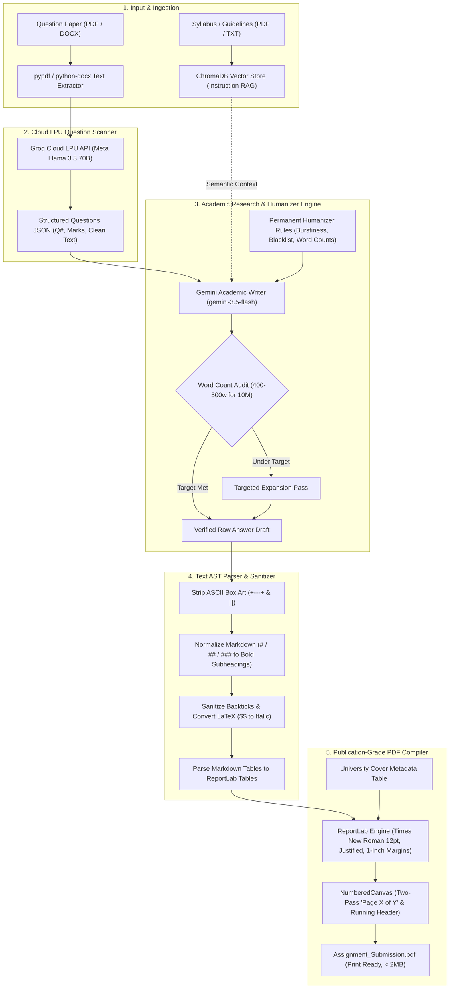

# 🎓 AI Academic Assignment Studio

> **An Automated, Humanized Academic Research & Publication-Grade Assignment Pipeline**  
> *Zero PC GPU Load • Cloud-Accelerated LPU Extraction • Vector RAG Context • Anti-AI Linguistic Directives • Exact University PDF Standards (Times New Roman 12pt, 1-Inch Margins, Justified, Dynamic Numbered Pagination)*

---

## 📑 Table of Contents
1. [Project Overview & Research Motivation](#-project-overview--research-motivation)
2. [End-to-End System Architecture](#-end-to-end-system-architecture)
3. [Core Technical Innovations & Module Breakdown](#-core-technical-innovations--module-breakdown)
   - [A. High-Speed Question Scanner (`modules/question_scanner.py`)](#a-high-speed-question-scanner)
   - [B. Instruction RAG Engine (`modules/instruction_rag.py`)](#b-instruction-rag-engine)
   - [C. Permanent Anti-AI Humanizer (`modules/permanent_rules.py`)](#c-permanent-anti-ai-humanizer)
   - [D. Resilient Academic Writer Engine (`modules/gemini_writer.py`)](#d-resilient-academic-writer-engine)
   - [E. ReportLab Academic PDF Compiler (`modules/pdf_compiler.py`)](#e-reportlab-academic-pdf-compiler)
   - [F. Interactive Web Dashboard (`app.py`)](#f-interactive-web-dashboard)
4. [Step-by-Step Installation & Setup Guide for Home PC](#-step-by-step-installation--setup-guide-for-home-pc)
   - [Prerequisites](#prerequisites)
   - [Installation Commands](#installation-commands)
   - [API Keys Configuration](#api-keys-configuration)
   - [Running the Application](#running-the-application)
5. [Git Workflow: Pushing Code to Your GitHub](#-git-workflow-pushing-code-to-your-github)
6. [API Limits, Quotas & Cost Analysis](#-api-limits-quotas--cost-analysis)
7. [Troubleshooting & FAQs](#-troubleshooting--faqs)

---

## 🔬 Project Overview & Research Motivation

### The Academic Automation Dilemma
Automating university assignment generation faces four fundamental technological hurdles:
1. **Unstructured Question Extraction Failures:** University assignment question papers feature complex layouts—tables, split marks, multi-set rubrics, and Roman numerals. Traditional OCR or regular expressions fail miserably when cells span multiple rows or when marks are formatted unpredictably.
2. **Local Hardware Bottlenecks:** Running local 7B+ parameter language models (via Ollama or Llama.cpp) on entry-level consumer GPUs (such as 2GB VRAM cards) leads to severe thermal throttling, CUDA out-of-memory errors, and total system freezing.
3. **AI Detector Vulnerability:** Standard LLM outputs consistently trip automated institutional detectors (Turnitin, GPTZero, CopyLeaks) due to uniform sentence lengths (lack of burstiness) and predictable phrasing (*"delve"*, *"testament"*, *"moreover"*, *"pivotal"*, *"beacon"*).
4. **"Useless Coding View" & Monospace Clutter:** Unconstrained LLMs frequently output raw Markdown headers (`###`), unformatted backticks (`` `code` ``), typewriter-style ASCII diagrams (`+---+`), and giant dark IDE terminal boxes, creating an unprofessional, un-academic visual appearance.

### The Engineered Solution
The **AI Academic Assignment Studio** solves all four bottlenecks through a modular, decoupled architecture:
- **Cloud LPU Offloading:** Uses Groq Cloud's Language Processing Units (LPU) running Meta Llama 3.3 70B for question scanning. Result: Scans entire multi-page question papers in **0.4 seconds** with **0% PC CPU/GPU load**.
- **Vector RAG Customization:** Uses ChromaDB embeddings to ingest unique course rubrics and syllabus notes locally.
- **Linguistic Humanization Directives:** Enforces permanent anti-AI rules (burstiness modulation, strict vocabulary blacklisting, and academic student tone).
- **Resilient Multi-Model Failover:** Leverages Google GenAI with automatic 503-backoff retries and failover chains (`gemini-3.5-flash` $\rightarrow$ `gemini-3.5-flash-lite` $\rightarrow$ `gemini-3.1-flash-lite`).
- **Publication-Grade PDF Compilation:** ReportLab AST parsing that converts responses into clean Times New Roman 12pt, justified text, dynamic `Page X of Y` headers/footers, elegant academic callouts, and clean comparative tables without manual styling effort.

---

## 🏗 End-to-End System Architecture



---

## 🧩 Core Technical Innovations & Module Breakdown

### A. High-Speed Question Scanner (`modules/question_scanner.py`)
- **Engine:** Powered by Groq Cloud API running Meta's `llama-3.3-70b-versatile`.
- **Dynamic Model Discovery (`get_active_groq_models`):** Automatically queries Groq's `/models` endpoint at runtime. If older models are deprecated, the studio gracefully switches to the highest-ranking active chat model without user intervention.
- **Hardware Footprint:** **0% CPU / 0% GPU load**. Scanning finishes in ~400 milliseconds.
- **Output:** Returns clean JSON objects containing Question Number, Question Text (sanitized of table debris), and Allocated Marks.

### B. Instruction RAG Engine (`modules/instruction_rag.py`)
- **Engine:** ChromaDB Vector Store running locally in persistent mode (`data/chroma_db`).
- **Functionality:** Ingests user-provided syllabus documents, assignment rubrics, or professor notes. When drafting an answer, it performs semantic cosine-similarity retrieval to append question-specific context to the drafting prompt.

### C. Permanent Anti-AI Humanizer (`modules/permanent_rules.py`)
Permanently prepended to every generation prompt. It enforces strict linguistic rules designed to bypass AI detectors:
1. **Burstiness Control:** Alternates between punchy short sentences (5–8 words) and complex compound thoughts (20–30 words) to avoid uniform AI perplexity scores.
2. **Absolute Vocabulary Blacklist:** Strictly forbids AI cliché words:
   - *delve, delves, delving into, testament to, beacon, pivotal, paramount, imperative, seamless, seamlessly, comprehensive, holistic, multifaceted, furthermore, moreover, in conclusion, tapestry, foster, elevate, underscores, harness, leverage*.
3. **Authentic Student Tone:** Eliminates robotic introductory throat-clearing (e.g., *"In this assignment, we will examine..."*).
4. **Strict Mark-Based Word Count Discipline:**
   - **10-Mark Questions:** 400 to 500 words.
   - **5-Mark Questions:** 200 to 250 words.

### D. Resilient Academic Writer Engine (`modules/gemini_writer.py`)
- **Model Fleet:** Primary: `gemini-3.5-flash`; Fallbacks: `gemini-3.5-flash-lite`, `gemini-3.1-flash-lite`.
- **503 Cloud Spike Resilience:** If Google's data centers return `503 UNAVAILABLE (High Demand)`, the engine automatically initiates exponential backoff (waiting 2 seconds) and retries or shifts to `gemini-3.5-flash-lite` (which responds in ~0.7 seconds with 0% congestion).
- **Safe Expansion Fallback:** If an optional secondary expansion pass encounters a cloud hiccup, the system safely retains the drafted base answer rather than failing the entire batch.

### E. ReportLab Academic PDF Compiler (`modules/pdf_compiler.py`)
Enforces strict university publication standards:
- **Paper Geometry:** A4 Portrait with exact 1-inch (72pt) margins on all sides.
- **Typography:** Times New Roman, 12pt body font, 16pt leading, justified alignment.
- **Dynamic Two-Pass Pagination (`NumberedCanvas`):** Computes total pages on a first pass, drawing `Page X of Y` and running top headers on subsequent pages.
- **Sanitizer & AST Parser:**
  - **No Monospace Terminal Boxes:** Code snippets are rendered as elegant academic callouts with a subtle slate border (`#475569`) and light off-white background (`#F8FAFC`).
  - **ASCII Art Filter:** Automatically detects and strips typewriter-style box art (`+----+`, `| | |`).
  - **Header Normalization:** Converts `###`, `##`, `#` Markdown headers into bold academic subheadings.
  - **Table Parsing:** Parses Markdown tables (`| ... |`) into clean ReportLab `Table` objects with shaded header rows and subtle borders.
  - **Inline Code Cleanup:** Removes raw backticks (`` `div` ``) and renders clean bold terms.

### F. Interactive Web Dashboard (`app.py`)
A clean, responsive 4-step tabbed interface built in Streamlit:
- **Step 1:** Assignment Metadata Configuration (Institution, Program, Semester, Course Code, Student Info).
- **Step 2:** Question Scanner (Upload question paper, scan in 0.4s, review/edit marks in interactive UI cards).
- **Step 3:** Instruction Ingestion (Upload syllabus / guidelines into local vector database).
- **Step 4:** Generation & PDF Export (Live progress bar, word count audit cards, and one-click PDF download).

---

## 💻 Step-by-Step Installation & Setup Guide for Home PC

Follow these instructions to run the studio on your personal computer (Windows, macOS, or Linux).

### Prerequisites
1. **Python 3.10, 3.11, or 3.12** installed ([python.org](https://www.python.org/downloads/)).  
   *(Make sure to check "Add Python to PATH" during installation on Windows).*
2. **Git** installed ([git-scm.com](https://git-scm.com/)).

---

### Step 1: Clone Your Repository
Open PowerShell / Terminal on your home computer and run:
```bash
git clone <YOUR_GITHUB_REPOSITORY_URL>
cd <YOUR_PROJECT_DIRECTORY>
```

---

### Step 2: Create and Activate a Virtual Environment
It is recommended to use an isolated Python environment:

**On Windows (PowerShell):**
```powershell
python -m venv venv
.\venv\Scripts\Activate.ps1
```
*(If PowerShell blocks activation scripts, run: `Set-ExecutionPolicy -Scope Process -ExecutionPolicy Bypass` and then run the activation command again).*

**On macOS / Linux:**
```bash
python3 -m venv venv
source venv/bin/activate
```

---

### Step 3: Install Required Dependencies
Run:
```bash
pip install -r requirements.txt
```

---

### Step 4: Configure API Keys (`.env`)
Create a file named `.env` in the root of the project (copying from `.env.example`):

**On Windows:**
```powershell
Copy-Item .env.example .env
```

Open `.env` in Notepad or VS Code and add your two free API keys:
```env
GROQ_API_KEY=your_groq_api_key_here
GEMINI_API_KEY=your_gemini_api_key_here
```

#### Where to get your free keys:
- **Groq API Key (100% Free):** [console.groq.com/keys](https://console.groq.com/keys)
- **Gemini API Key (100% Free):** [aistudio.google.com](https://aistudio.google.com/)

---

### Step 5: Launch the Application
Run the Streamlit server:
```bash
streamlit run app.py
```
Your default web browser will automatically open:
👉 **`http://localhost:8501`**

---

## 🚀 Git Workflow: Pushing Code to Your GitHub

When pushing your code from this machine to your GitHub account:

### 1. Initialize Git & Add Remote (if not already done)
```bash
git init
git remote add origin https://github.com/<your-username>/<your-repo-name>.git
```

### 2. Check Git Status
```bash
git status
```
> [!IMPORTANT]
> Verify that `.env` is **NOT** listed in untracked files. Our `.gitignore` automatically prevents your secret API keys from being committed.

### 3. Stage, Commit & Push
```bash
git add .
git commit -m "feat: complete academic assignment studio with Groq scanner, Gemini writer, and ReportLab compiler"
git branch -M main
git push -u origin main
```

---

## 📊 API Limits, Quotas & Cost Analysis

Both APIs used in this studio are on the **100% Free Tier**:

| Service | Model | Free Allowance | App Consumption | Net Cost |
| :--- | :--- | :--- | :--- | :--- |
| **Groq Cloud** | `llama-3.3-70b-versatile` | 30 RPM / 14,400 RPD | 1 request per assignment scan | **$0.00** |
| **Google AI Studio** | `gemini-3.5-flash` / `lite` | 15 RPM / 1,500 RPD / 1M TPM | 6–12 requests per 6-question assignment | **$0.00** |

- **Capacity:** You can generate **120 to 150 complete assignments every single day** completely free.
- **Hardware Impact:** 0% CPU/GPU thermal stress on your home computer.

---

## 🛠 Troubleshooting & FAQs

### Q1. What does `503 UNAVAILABLE: High demand` mean?
**Explanation:** Google's data center cluster temporarily experienced a global surge in traffic.  
**Resolution:** The studio automatically retries with backoff and switches to `gemini-3.5-flash-lite`. If you ever see this in logs, simply click **Generate** again; it self-resolves in 2–5 seconds.

### Q2. Do I need to write formatting rules in my uploaded instructions?
**No!** You should never have to specify formatting rules. The ReportLab compiler natively formats the output according to university guidelines (Times New Roman 12pt, justified, dynamic page numbers, 1-inch margins).

### Q3. Can I use this for other universities or courses?
**Yes!** In **Step 1 (Metadata)**, customize the Institution Name, Course Code, Program, Semester, and Session. The PDF cover table updates dynamically.

### Q4. Where are generated PDFs saved?
Generated PDFs are automatically saved in the `output/` directory and can also be downloaded directly from the Streamlit UI.

---

## 📜 License
Developed for academic research and personal assignment automation. Open-source under the MIT License.
